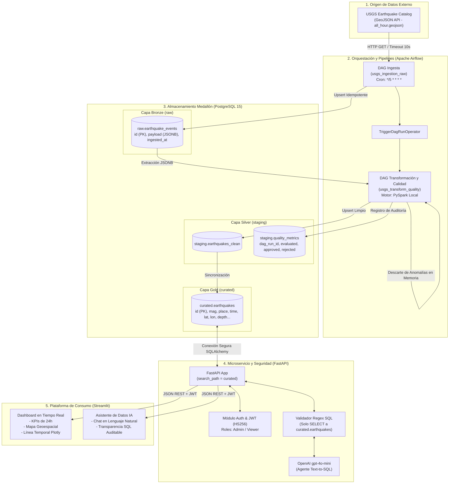

# 🏛 Documento de Arquitectura de Datos y Sistemas - SismoWatch

---

## 1. Contexto de Negocio y Propósito de la Arquitectura

### 1.1 El Desafío
**SuperApp** ha creado **SismoWatch**, su vertical corporativa orientada al monitoreo sísmico global y la gestión proactiva de riesgos. Las áreas de operaciones, logística y seguridad patrimonial demandan información precisa, consolidada y en tiempo casi real respecto a movimientos telúricos (ubicación geográfica exacta, profundidad, hora precisa y magnitud) para la toma de decisiones críticas.

Históricamente, la organización dependía del feed público provisto por el **Servicio Geológico de los Estados Unidos (USGS)**. No obstante, este origen presentaba serias debilidades operacionales:
1. **Volatilidad y Pérdida de Historial:** La fuente publica ventanas cortas de tiempo (por ejemplo, la última hora en formato GeoJSON) y no conserva un histórico auditable.
2. **Mutabilidad de los Eventos:** Un evento sísmico puede ser publicado preliminarmente y luego ser recalculado (variando su magnitud, profundidad o estatus de revisión), generando duplicados o inconsistencias si la carga no es idempotente.
3. **Falta de Validación Estructural:** No existía control de calidad sobre anomalías en coordenadas geográficas, campos nulos o fallas de transmisión.
4. **Barrera de Acceso y Análisis:** Los analistas no contaban con una plataforma centralizada de visualización ni con herramientas intuitivas para formular consultas complejas en lenguaje natural sin riesgo de alucinaciones matemáticas.

### 1.2 El Propósito de la Solución
La arquitectura de **SismoWatch** convierte este feed público volátil en un **producto de datos empresarial confiable, seguro y auditable**. Implementa una **Arquitectura Medallón** automatizada de punta a punta, garantizando:
- Ingesta continua e idempotente sin intervención manual.
- Procesamiento distribuido y control de calidad riguroso en memoria mediante PySpark.
- Gobernanza de datos y aislamiento estricto de esquemas en PostgreSQL.
- Acceso seguro mediante microservicios protegidos con JWT y control de acceso basado en roles (RBAC).
- Plataforma de visualización en tiempo real y asistente inteligente de analítica respaldado por un patrón Text-to-SQL estricto que elimina alucinaciones.

---

## 2. Diagrama de Arquitectura y Flujo de Datos



---

## 3. Arquitectura Medallón (Diseño de Capas de Datos)

El almacenamiento se diseñó bajo el patrón de **Arquitectura Medallón**, separando responsabilidades lógicas y niveles de procesamiento en esquemas específicos dentro de PostgreSQL:

| Capa | Esquema | Tablas Principales | Rol Arquitectónico | Formato y Características |
| :--- | :--- | :--- | :--- | :--- |
| **Bronze** | `raw` | `raw.earthquake_events` | Ingesta cruda inmutable | Almacenamiento de eventos en formato nativo `JSONB`. Garantiza trazabilidad y permite reprocesar la historia completa si las reglas de negocio cambian. |
| **Silver** | `staging` | `staging.earthquakes_clean`<br/>`staging.quality_metrics` | Limpieza, estandarización y calidad | Desempaquetado del JSON a columnas tipadas. Aplicación de reglas de calidad con PySpark. Auditoría histórica de calidad. |
| **Gold** | `curated` | `curated.earthquakes` | Consumo analítico y servicio | Tabla estructurada, optimizada con índices primarios para consultas de agregación, visualización en el dashboard y consultas del LLM. |

### 3.1 Capa Bronze (`raw`)
- **Propósito:** Almacén de aterrizaje inmutable (*Landing zone*).
- **Esquema:**
  ```sql
  CREATE TABLE IF NOT EXISTS raw.earthquake_events (
      id VARCHAR(100) PRIMARY KEY,
      payload JSONB NOT NULL,
      ingested_at TIMESTAMP DEFAULT CURRENT_TIMESTAMP
  );
  ```
- **Idempotencia:** Ante múltiples ejecuciones del pipeline sobre la misma ventana temporal, se aplica la cláusula `ON CONFLICT (id) DO UPDATE SET payload = EXCLUDED.payload, ingested_at = CURRENT_TIMESTAMP`. Esto evita duplicidad y captura modificaciones oficiales del USGS en eventos preexistentes.

### 3.2 Capa Silver (`staging`)
- **Propósito:** Transformación, estandarización de tipos y filtrado de calidad.
- **Motor de Calidad:** PySpark local embebido en Airflow.
- **Métricas de Observabilidad (`staging.quality_metrics`):**
  ```sql
  CREATE TABLE IF NOT EXISTS staging.quality_metrics (
      id SERIAL PRIMARY KEY,
      dag_run_id VARCHAR(255),
      evaluated_records INT,
      approved_records INT,
      rejected_records INT,
      executed_at TIMESTAMP DEFAULT CURRENT_TIMESTAMP
  );
  ```
- **Política de Anomalías:** Conforme a las directrices de diseño, las filas que no cumplen las reglas de calidad son eliminadas directamente de la memoria de PySpark para evitar la persistencia de datos corruptos, mientras que los contadores de rechazo quedan registrados en `staging.quality_metrics` para monitoreo operacional.

### 3.3 Capa Gold (`curated`)
- **Propósito:** Capa de servicio para analítica de negocio, APIs y modelos de lenguaje.
- **Esquema:**
  ```sql
  CREATE TABLE IF NOT EXISTS curated.earthquakes (
      id VARCHAR(100) PRIMARY KEY,
      mag DOUBLE PRECISION,
      place TEXT,
      time BIGINT,
      updated BIGINT,
      tz INT,
      url TEXT,
      detail TEXT,
      felt INT,
      cdi DOUBLE PRECISION,
      mmi DOUBLE PRECISION,
      alert VARCHAR(50),
      status VARCHAR(50),
      tsunami INT,
      sig INT,
      net VARCHAR(50),
      code VARCHAR(50),
      ids TEXT,
      sources TEXT,
      types TEXT,
      nst INT,
      dmin DOUBLE PRECISION,
      rms DOUBLE PRECISION,
      gap DOUBLE PRECISION,
      magType VARCHAR(50),
      type VARCHAR(50),
      title TEXT,
      longitude DOUBLE PRECISION,
      latitude DOUBLE PRECISION,
      depth DOUBLE PRECISION,
      created_at TIMESTAMP DEFAULT CURRENT_TIMESTAMP
  );
  ```

---

## 4. Decisiones Técnicas y Justificación de Trade-offs

En el diseño de sistemas de datos de misión crítica, cada elección tecnológica responde a un balance reflexivo entre complejidad, rendimiento, costo y requisitos de entrega:

### 4.1 Apache Airflow vs. Tareas Cron / Scripts Ad-hoc
- **La Disyuntiva:** Podría haberse utilizado un simple script de Python programado en el `crontab` del sistema operativo.
- **La Decisión:** Se seleccionó **Apache Airflow**.
- **Justificación:** Los cron jobs son opacos: carecen de interfaz centralizada de observabilidad, no manejan dependencias complejas entre tareas, no gestionan reintentos exponenciales con manejo de estado, ni ofrecen trazabilidad histórica de ejecuciones. Con Airflow, logramos separar la ingesta de la transformación mediante `TriggerDagRunOperator`, asegurando que la fase de PySpark solo se inicie si la ingesta HTTP concluyó con éxito.

### 4.2 PySpark en Modo Local vs. Clúster Distribuido Externo (Databricks / AWS EMR)
- **La Disyuntiva:** Levantar un clúster dedicado de Spark o ejecutar Spark en el entorno de los contenedores de Airflow.
- **La Decisión:** Se configuró **PySpark en modo local (`local[*]`)** sobre una imagen Docker personalizada de Airflow que incluye Java Runtime (`default-jre-headless`).
- **Justificación:** Para el volumen de datos de eventos sísmicos de ventanas horarias, aprovisionar infraestructura distribuida en la nube introducía latencias de red innecesarias, sobrecostos de facturación y complejidad de administración. PySpark local proporciona la misma API unificada y el poder del motor Tungsten en memoria sin la sobrecarga de un clúster externo, cumpliendo los requerimientos de procesamiento riguroso y permitiendo una portabilidad total en cualquier máquina con Docker.

### 4.3 Agente de IA: Patrón Text-to-SQL de 2 Fases vs. RAG Tradicional con Embeddings
- **La Disyuntiva:** Indexar la información en una base de datos vectorial (ChromaDB / Pinecone) y responder mediante Retrieval-Augmented Generation (RAG) o utilizar un enfoque Text-to-SQL guiado.
- **La Decisión:** Se implementó una **arquitectura Text-to-SQL estricta en dos pasos** con validación intermedia.
- **Justificación:** Los modelos vectoriales son excelentes para documentos no estructurados (textos, contratos), pero deficientes para responder preguntas analíticas deterministas ("¿cuál es la magnitud máxima?", "¿cuántos sismos superaron 4.5 en las últimas 24 horas?"). El LLM tiende a alucinar cifras en cálculos numéricos agregados. Con Text-to-SQL:
  1. El LLM traduce la pregunta a una sintaxis SQL precisa.
  2. El backend valida la seguridad de la consulta mediante regex y la ejecuta en PostgreSQL.
  3. Los datos numéricos exactos de la base de datos se inyectan en el prompt final, forzando al modelo a responder estrictamente con base en los hechos verificados.

### 4.4 Streamlit vs. Aplicación SPA (React / Next.js)
- **La Disyuntiva:** Desarrollar un cliente desacoplado en TypeScript con React o utilizar Streamlit.
- **La Decisión:** Se seleccionó **Streamlit**.
- **Justificación:** Streamlit permite a un equipo de datos iterar rápidamente y desplegar interfaces analíticas completas con mapas de densidad geoespacial, widgets dinámicos y paneles de chat en un tiempo récord, manteniendo un stack 100% Python coherente con el resto del proyecto.

### 4.5 Polling Coordinado (5 minutos) vs. WebSockets / SSE
- **La Disyuntiva:** Abrir una conexión persistente por WebSockets hacia la fuente pública o realizar sondeos periódicos.
- **La Decisión:** **Polling coordinado a 5 minutos** orquestado por Airflow.
- **Justificación:** El servicio USGS Earthquake Catalog publica sus actualizaciones en lotes con una frecuencia típica de entre 1 y 5 minutos; no ofrece un broker de streaming ni una API pública nativa de WebSockets. Mantener WebSockets artificiales o realizar peticiones cada segundo saturaría los servidores del USGS y generaría riesgos de rate limiting (bloqueo por IP). Un ciclo de 5 minutos representa el balance ideal entre frescura del dato, cortesía con la API pública y uso eficiente de CPU y red.

---

## 5. Arquitectura de Seguridad, Gobernanza y RBAC

El sistema incorpora controles de seguridad integrales en cada componente:

```
[ Usuario No Autenticado ] ──▶ [ Intento de Acceso ] ──▶ HTTP 401 Unauthorized
[ Usuario 'viewer' ]       ──▶ [ Token JWT ]         ──▶ Solo Lectura (Dashboard & Chat)
[ Usuario 'admin' ]        ──▶ [ Token JWT ]         ──▶ Acceso Total
```

### 5.1 Principio de Menor Privilegio en Base de Datos
- Las conexiones del microservicio de consumo FastAPI restringen su espacio de búsqueda exclusivamente al esquema `curated` mediante la configuración de conexión:
  ```python
  engine = create_engine(
      DATABASE_URL,
      connect_args={"options": "-c search_path=curated"}
  )
  ```
- La aplicación carece de visibilidad directa sobre las tablas crudas o las métricas internas de calidad del esquema `staging`.

### 5.2 Autenticación y Autorización por Tokens JWT
- Autenticación sin estado (*stateless*) mediante tokens firmados con el algoritmo criptográfico **HMAC-SHA256 (HS256)** y expiración configurada a 12 horas.
- La identidad y el rol (`admin` o `viewer`) se transportan en los *claims* del payload del token.
- Todo endpoint analítico (`/api/kpis`, `/api/events`, `/api/chat`) exige la inyección de la dependencia `get_current_user`, denegando llamadas anónimas con código `HTTP 401 Unauthorized`.

### 5.3 Mitigaciones OWASP Top 10 para LLMs
1. **Prevención de Inyección de Comandos (SQL Injection / Prompt Injection):**
   - El SQL generado por la IA es analizado por un filtro sintáctico riguroso mediante expresiones regulares antes de cualquier ejecución:
     - Solo se admiten sentencias que comiencen estrictamente por `SELECT`.
     - Se bloquean de forma terminante palabras clave DDL y DML potencialmente destructivas (`DROP`, `DELETE`, `UPDATE`, `INSERT`, `ALTER`, `TRUNCATE`, `GRANT`, `REVOKE`, `EXEC`).
     - Se valida que la tabla destino coincida unívocamente con `curated.earthquakes`.
     - Si la consulta transgrede estas reglas, el microservicio aborta la petición con código `HTTP 403 Forbidden`.
2. **Prevención de Fugas de Datos Sensibles (Sensitive Information Disclosure):**
   - Las credenciales de base de datos y la llave de OpenAI residen estrictamente en variables de entorno inyectadas en tiempo de ejecución. Ningún secreto forma parte del repositorio ni del historial de Git (`.env` está ignorado en `.gitignore`).

---

## 6. Resiliencia, Idempotencia y Manejo de Fallos

| Escenario de Falla | Mecanismo de Mitigación Implementado |
| :--- | :--- |
| **Caída o lentitud de la API de USGS** | Peticiones HTTP protegidas con `timeout=10` segundos. En caso de corte, la tarea de Airflow falla de forma controlada y aplica reintentos automáticos sin corromper el estado anterior. |
| **Actualizaciones o duplicados del USGS** | Inserciones protegidas mediante cláusulas `ON CONFLICT (id) DO UPDATE` en todas las capas del pipeline. Reprocesar el mismo feed mil veces produce exactamente el mismo resultado final. |
| **Registros con anomalías geográficas o nulos** | PySpark filtra y descarta los registros en memoria antes de la persistencia. Se deja constancia cuantitativa en `staging.quality_metrics`. |
| **Agotamiento de cuota o fallo de OpenAI** | El backend captura excepciones de red y de API del SDK de OpenAI, retornando respuestas estructuradas de contingencia sin producir errores de servidor (500) ni pantallas en blanco en Streamlit. |
| **Reinicios no programados de contenedores** | Políticas de Docker Compose configuradas con `restart: unless-stopped` y comprobaciones de salud (`healthcheck`) activas en PostgreSQL. |

---

## 7. Hoja de Ruta para Escalabilidad y Producción

Para evolucionar esta solución hacia una plataforma de escala global con soporte para millones de transacciones por segundo, se contemplan las siguientes fases arquitectónicas:

1. **Arquitectura Orientada a Eventos (Real-time Streaming):**
   - Incorporar **Apache Kafka** o **Amazon Kinesis** como bus de mensajería para eventos sísmicos.
   - Sustituir las tareas batch de Airflow por un proceso continuo de **Spark Structured Streaming** o **Apache Flink**, reduciendo la latencia de ingestión a submilisegundos.
2. **Infraestructura de Datos Distribuida:**
   - Migrar PostgreSQL hacia un Lakehouse estructurado basado en **Apache Iceberg** o **Delta Lake** sobre almacenamiento de objetos (Amazon S3 / Google Cloud Storage).
   - Ejecutar las transformaciones sobre clústeres elásticos gestionados con **AWS EMR Serverless** o **Databricks**.
3. **Escalado Horizontal de Orquestación:**
   - Migrar la configuración de Airflow `LocalExecutor` hacia **KubernetesExecutor** desplegado en un clúster EKS/GKE, permitiendo el aislamiento dinámico de pods por tarea.
4. **Caché y Réplicas de Lectura:**
   - Incorporar una capa de caché en memoria con **Redis** para los endpoints `/api/kpis` y `/api/events`, disminuyendo la carga de lectura en la base de datos principal.
5. **Observabilidad Avanzada para Modelos de Lenguaje:**
   - Instrumentar el agente Text-to-SQL con herramientas como **OpenInference** y **Phoenix / LangSmith** para auditar costos de inferencia, métricas de latencia de tokens y tasas de éxito en generación de SQL.
